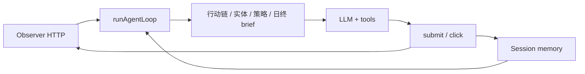
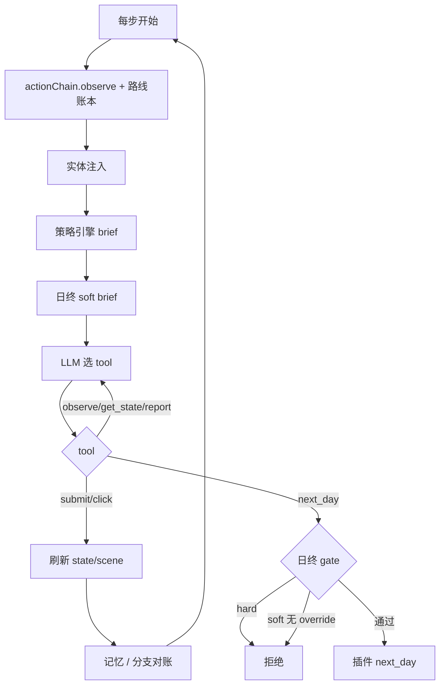
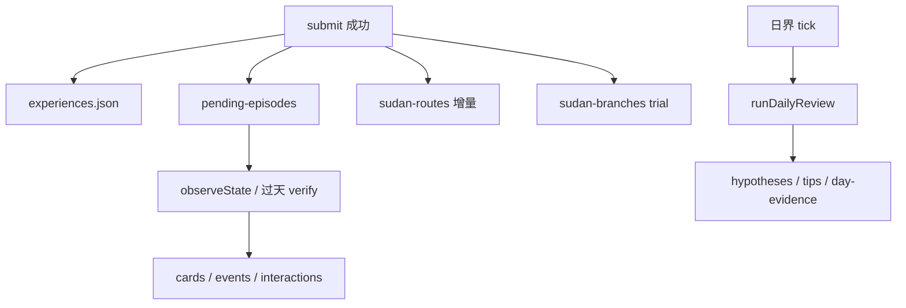

# Sultan Agent 架构说明

本文面向维护者，说明 `agents/sultan` 如何启动与运转、一日游玩如何编排、记忆如何沉淀，以及几条决策引擎的判定逻辑。机制级日流程细节另见 [docs/games/sultan/action-chain.md](../../docs/games/sultan/action-chain.md)；人类攻略见 [strategy-guide.md](../../docs/games/sultan/strategy-guide.md)（不整包灌入 prompt）。

---

## 1. 总览

### 1.1 角色边界

| 层 | 职责 |
|----|------|
| **游戏 + SultanObserver 插件** | 读 Unity 状态、扫语义 UI、执行 typed / click 动作；HTTP 暴露 `/health` `/state` `/scene` `/actions` |
| **TypeScript Agent** | LLM 决策、行动链编排、策略/日终检定、会话记忆与复盘；只通过 `GameOps` 接口访问游戏 |

Agent 实现位于 `src/game/HttpGameOps.ts`，契约为 `src/game/GameOps.ts`：

- `getState(views?)` — 结构化状态（day、cards、rites、sudan、actions…）
- `observeScene()` — 语义 UI（elements / affordances / instruction）
- `submitActions(actions)` — 提交游戏动作批
- `publishDecision` / `publishLlmStats` — HUD 与遥测（可选）

原则：**界面以 `observe_scene` 为准，参数以 `get_state` 为准，过天必须显式 `next_day`。**

### 1.2 启动入口

| 入口 | 文件 | 用途 |
|------|------|------|
| 单局 | `src/index.ts` | `npm start`：解析 memory CLI → health → `bootIntoPlay` → `runAgentLoop`；可从 session meta 恢复日复盘 cursor |
| 多局 | `src/orchestrator.ts` | `npm run autoplay`：循环开新局；每局重置 day-review cursor，保留 hypotheses/tips |
| 进局 | `src/memory/boot.ts` | `bootIntoPlay`：从 boot/menu 进入 play，不做教程交互 |

会话由 `src/memory/session.ts` 管理（`--fresh` / `--memory` / `--list`），数据落在 `agents/sultan/memory/sessions/<id>/`。

### 1.3 一句话数据流

```
observe / 注入 brief → LLM + tools → submit_actions / click_element
  → 刷新 state+scene → 写记忆（经验/实体/episode/路线/分支）→ 重规划
```



---

## 2. 运行原理（主循环）

核心：`src/agent/loop.ts` 的 `runAgentLoop()`。

### 2.1 初始化（有 `memoryDir` 时）

- `ExperienceStore` → `experiences.json`
- `createSultanEntityStores` → `cards.json` / `events.json` / `interactions.json`
- `EpisodeTracker` + `EpisodeStore` → `pending-episodes.json`
- `SudanRouteStore` / `SudanBranchStore` → `sudan-routes.json` / `sudan-branches.json`
- `ActionChainController`、日界 `DayBoundaryState`、可选 Enrichment Worker

### 2.2 每步循环

1. **行动链刷新**：`actionChain.observe` + `syncSudanRouteLedger`；brief 变化则注入用户消息。
2. **实体记忆注入**（`hand_review` … `local_improve`）：按当前手牌/地图检索 Top-K，`buildEntityMemoryInjection`。
3. **策略引擎**（`map_review` … `end_day_gate`）：`runStrategyEngine` → `formatStrategyBrief`；同时把 place 候选灌入 `dayCloseLedger`。
4. **日终 soft brief**（`local_improve` / `end_day_gate`）：`reviewDayCloseAllocations` → 建议性文本（硬拦在 tools）。
5. **LLM**：`createTimedChatCompletion` + `agentTools`；上下文过长时后台压缩。
6. **工具执行**：`runTool`（见下节）。
7. **动作后刷新**（`submit_actions` / `click_element` 成功）：
   - 再拉 `getState` + `observeScene`
   - 更新行动链与苏丹路线账本
   - 分支试验：`startTrial` / `prev_round`→`markRewound` / 成功销卡→`commit`
   - 学习写入：经验、实体、episode（**active 分支期间 isolateLearning**，不进 canonical）
   - `next_day` 触发日界 tick，可能跑 `runDailyReview` 并注入「本局每日记忆」

终局：`isTerminalState`；失败优先 `prev_round`，否则 `start_new_game`（见 system prompt / tools）。

### 2.3 工具面

文件：`src/agent/tools.ts`。LLM 可见工具共 5 个：

| 工具 | 作用 |
|------|------|
| `observe_scene` | 读当前语义 UI |
| `click_element` | 点击当前快照中 enabled 元素（需 `elementId` + `snapshotVersion`） |
| `get_state` | 多 view 状态（compact / cards / rites / …） |
| `submit_actions` | 提交游戏动作批 + `decision`；可选 `dayCloseReviewOverride` |
| `report_action_chain` | 上报 checklist（Top3、allocations、idleCards、sudanBreakDone 等） |

**`next_day` 真实门禁**在 `runDayCloseReviewGate`（不是行动链 checklist）：

1. 跑 `reviewDayCloseAllocations`
2. **硬问题** → 拒绝，`day_close_hard_issue`
3. **软改进**（分数可提升等）→ 需非空 `dayCloseReviewOverride`，否则 `day_close_improvement_available`
4. 禁止用 `click_element` 点「下一天」绕过（`use_explicit_next_day`）



---

## 3. 游玩流程（行动链）

实现：`src/agent/actionChain.ts`。阶段枚举 `ActionChainPhase`：

```
entry_setup → sudan_draw → daily_news → hand_review → map_review
  → synthesis → allocation → local_improve → end_day_gate
```

另有打断态：`blocked`（引导/浮层）、`terminal`。

### 3.1 阶段职责（摘要）

| 阶段 | 要做什么 |
|------|----------|
| `entry_setup` | 难度 / 加点 / 剧情选项 |
| `sudan_draw` | `draw_sudan_card` 正式进日循环 |
| `daily_news` | 仅处理已弹出的 StoryNotify；禁止打开「一千零一夜」 |
| `hand_review` | 盘点手牌；未知用途 `inspect_card`；可换装 |
| `map_review` | `open_rite` 扫地图；**新苏丹卡 / 新 event → sudan_route_probe（advisory）** |
| `synthesis` | Top3 + `report_action_chain` |
| `allocation` | 按优先级放卡；苏丹按滚动策略准备/试验/提交 |
| `local_improve` | 移动/交换/reset/换装/换卡/`prev_round` |
| `end_day_gate` | 日终检定后显式 `next_day`，再回 `daily_news` |

### 3.2 Advisory vs 硬门禁

- 行动链 `canAdvanceDay`、`missing[]`（含 `sudan_route_probe`、`execution_break_today` 等）均为 **流程建议**，不单独拒绝 `submit_actions`。
- **硬门禁**：日终检定 hardIssues + 插件侧物理约束（遮罩、仪式面板未关、引导等）。
- `mustInspect`：稳定 `cardId` 无可靠说明时，需成功的 `inspect_card` + 可靠 `cardSummary`；`report_action_chain` 自报不能绕过。

### 3.3 苏丹卡滚动策略（现行）

处刑倒计时 `executionDaysLeft`（由 `day` 与 `sudan.initLife` 推导）。**不再**使用固定「提前销卡 -18/-12/-8」惩罚。

| 剩余天数 | policy | 行为 |
|---------|--------|------|
| 通常 7–3 | `discover_routes` / `accumulate_prepare` | 探测兼容路线；积累资源与前置；即将过期的优质机会可提前执行 |
| 2 | `branch_test` | 试验非支配分支（最佳/次优路线、换卡）；同签名不重复；约 5 候选上限 |
| 1 | `commit_best` | 执行已验证最佳分支 |
| ≤0 | `emergency` | 必须先销卡；简单模式可 `prev_round` |

换卡：`open_sudan_box` → `exchange_sudan_card`（精确文案「交换手上的苏丹卡」）；**不重置倒计时**。  
回退：`prev_round` 状态回档，灵视 `counters["7100005"]` +1（轻度机会成本，不硬限回退）。

更细的 checklist / 日终规则见 action-chain 文档；策略文案见 `src/agent/systemPrompt.ts`。

---

## 4. 记忆形成规则

### 4.1 Session 文件布局

根目录：`agents/sultan/memory/sessions/<id>/`（`createMemorySession` / `openMemorySession`）。

| 文件 | 职责 |
|------|------|
| `meta.json` | 会话 id、标签、`lastReviewedDay`、`activeHypothesisId` |
| `experiences.json` | 动作级原始证据（可按 signature 聚合） |
| `cards.json` / `events.json` / `interactions.json` | 实体知识蒸馏 |
| `fingerprint-aliases.json` | 冷启动 fingerprint ↔ 完整 catalog 互认 |
| `pending-episodes.json` | 仪式归因链 place→execute→settle |
| `sudan-routes.json` | 当前周期苏丹兼容路线账本 |
| `sudan-branches.json` | 可回退分支试验账本 |
| `hypotheses.json` / `tips.json` / `experiment-ledger.json` | 跨日假设、tips、验证队列 |
| `day-evidence.jsonl` | 日行证据 |
| `outcomes.jsonl` | 终局/日 outcome（autoplay 等追加） |
| `skills/` | 慢环蒸馏的 skill playbook |
| `enrichment-queue.jsonl` | 后台 soft-fact 富化队列 |

### 4.2 分层与写入时机



1. **动作经验**（`experienceAdapter.recordActionExperience`）  
   记录 op、前后 metrics、prediction vs actual；供策略检索加权。

2. **Episode 归因**（`episodeAdapter` + `EpisodeTracker`）  
   - `place_card_on_rite` 开/续 placement  
   - `execute` / `start_rite` 冻结输入组合（含空槽）  
   - 骰点类可当场结算；剧情类进跨天验证  
   - 结算后 `applyRiteSettlement` 回写实体 sample / usages  
   - `quarantined` / `rewound` **不**更新 canonical 实体

3. **实体知识**（`entityAdapter` / `entityMemory`）  
   - 稳定键：`configFingerprint:card:<cardId>`、`…:rite:<riteId>`、interaction 哈希  
   - 运行时 `uid` 仅当局交互，不跨局  
   - 晋升大致：`observed → provisional → validated`；冲突可降置信或 `contradicted`  
   - 注入：仅 Top-K；`validated` 可参与 planner 低优先级加权；生存/期限/合法性始终优先

4. **苏丹路线账本**（`sudanRouteStore` + `sudanRouteTracker`）  
   - key：`configFingerprint|sudan:cardId|eventKey|slot:index`  
   - 新卡/新 map `added:` → pending probe；打开 event 后读苏丹卡 `place_card_on_rite` affordance 写入 `compatible|ready|needs_support|…`  
   - 只记「当前周期可行性与工期」；长期结果仍靠实体记忆

5. **分支账本**（`sudanBranchStore`）  
   - 剩 ≤2 天且出现换卡/放苏丹/提交等 trial op → `startTrial`  
   - active 期间：经验/实体写入隔离（pendingEvidence）；episode 带 `branchId`  
   - `prev_round` → `rewound` + quarantine；`execute` 成功销卡 → `committed`  
   - 同 anchor+action signature 不重复试验

6. **日复盘**（`dayReview.ts` / `dayBoundary.ts`）  
   过天反馈排空后、下一天分配前同步复盘：写 day-evidence、评估/生成 hypothesis、注入记忆后再继续。

### 4.3 Enrichment

后台 Worker（默认单并发）只整理 usages / bestPractices 等 soft facts，不改 sampleCount，不阻塞主循环。开关见 `env/.env.example` 的 `AGENT_ENTITY_ENRICH_*`。

---

## 5. 决策引擎

### 5.1 策略引擎流水线

文件：`src/planner/strategyEngine.ts` → `runStrategyEngine`。

```
buildStrategySnapshot（含 sudanCard / sudanRoutes / insight / rewindAvailable）
  → generateEventConfigurations（当前 scene 合法 place / open / bare ops）
  → retrieveForConfigurations + attachExperienceIds
  → retrieveRelevantEntityKnowledge + attachEntityKnowledge
  → beamSearchDayPlans（+ localSearch 局部改进）
  → recommendedPlanId / firstAction
```

注入时机：行动链进入 `map_review` 及之后。LLM 收到 `formatStrategyBrief`，宜只执行 plan **第一步**，动作后重观察重规划。

候选来源：`candidateGenerator.ts`（单槽/多槽 place、`open_rite`、`open_sudan_box` / `exchange_sudan_card` / `prev_round` / `next_day` 等）。未打开仪式则无 place 候选——日终会标 evidence incomplete。

### 5.2 处刑 timing

文件：`src/planner/executionTiming.ts`。

- `adviseExecutionTiming(snapshot)` → policy + hint + `lethalIfUnbroken`
- `scoreExecutionTiming` → 供评分第 1 维；**无固定早销重罚**；过期优质路线可提前加分
- `planBreaksSudanCard` → 配置是否含销苏丹路径

Policy 名见 §3.3。输入侧会读路线覆盖率、ready/needs_support、pending probes、换卡剩余、rewind 可用性等（经 `StrategySnapshot.sudanRoutes` / `sudanCard`）。

### 5.3 评分词典序

文件：`src/planner/scorer.ts` → `scorePlanVector` / `compareScoreVectors`（从左到右字典序，数值越大越好）。

| 维 | 含义 |
|----|------|
| 0 | 生存 / 硬期限（末日过天未销等） |
| 1 | 路线可行性 + execution timing |
| 2 | 即将过期的销卡/限时机会 |
| 3 | 已验证收益/代价（经验 + 实体知识分） |
| 4 | 路线准备度 / 探测与分支试验偏好 |
| 5 | 灵视增量（`prev_round` 轻度负分） |
| 6 | 持续/循环收益（治理家业、权力的游戏等） |
| 7 | 品阶匹配 |
| 8 | 可复用利用率 + 普通资源 |
| 9 | 机会成本（高阶浪费、长锁回合）取负 |

Beam：`beamSearch.ts`（默认 beamWidth≈24，单步执行）；`next_day` 不与 productive work 同 plan。局部搜索：`localSearch.ts`。

### 5.4 日终分配检定

文件：`src/planner/dayCloseReview.ts`；门禁调用在 `tools.ts`。

日流程中打开仪式时，宿主把合法 place 配置缓存进 **DayCandidateLedger**，过天前与当前 allocations 对账，并做跨事件 beam + local search 对比。

| 等级 | 典型条件 | 行为 |
|------|----------|------|
| **硬** | 可复用余牌仍有已验证正收益槽；分配漂移/陈旧 | 拒绝 `next_day` |
| **软 / advisory** | 分数可提升；苏丹路线未探测完；末日可销未销；换卡机会 | 返回建议；苏丹相关**不硬拦**；分数改进需 override 或调整后重试 |
| **放行** | 无硬问题且软改进已处理或已 override | 调用插件 `next_day` |

证据不全时降置信，不把推测升级为硬拒。

### 5.5 与 LLM 的分工

| 组件 | 确定性 | 作用 |
|------|--------|------|
| 行动链 | 是 | 阶段优先级与 checklist 提示 |
| 策略引擎 / 日终检定 | 是 | 合法候选、排序、过天门禁 |
| LLM | 否 | 在 enabled affordances 内选步、解释、处理异常 UI |
| 实体 Enrichment | 异步 | 文案级整理，不挡主循环 |

---

## 6. 关键文件索引

| 主题 | 路径 |
|------|------|
| 单局入口 | `src/index.ts` |
| Autoplay | `src/orchestrator.ts` |
| 主循环 | `src/agent/loop.ts` |
| 工具与 next_day gate | `src/agent/tools.ts` |
| 行动链 | `src/agent/actionChain.ts` |
| System prompt | `src/agent/systemPrompt.ts` |
| 策略引擎 | `src/planner/strategyEngine.ts` |
| 候选生成 | `src/planner/candidateGenerator.ts` |
| Beam / 局部搜索 | `src/planner/beamSearch.ts`, `localSearch.ts` |
| 评分 | `src/planner/scorer.ts` |
| 处刑 timing | `src/planner/executionTiming.ts` |
| 日终检定 | `src/planner/dayCloseReview.ts` |
| Snapshot 构建 | `src/memory/experienceAdapter.ts` |
| 类型契约 | `src/game/strategyTypes.ts` |
| Session | `src/memory/session.ts` |
| 实体 / episode / 日复盘 | `src/memory/entityMemory.ts`, `entityAdapter.ts`, `episodeStore.ts`, `episodeTracker.ts`, `dayReview.ts`, `dayBoundary.ts` |
| 苏丹路线 / 分支 | `src/memory/sudanRouteStore.ts`, `sudanBranchStore.ts`, `sudanRouteTracker.ts` |
| GameOps | `src/game/GameOps.ts`, `HttpGameOps.ts` |
| 日流程文档 | `docs/games/sultan/action-chain.md` |
| 校验脚本 | `scripts/verify-*.ts`（strategy / action-chain / day-close-review / sudan-routes / entity-memory / episode-tracker 等） |

运行日志：`agents/sultan/logs/runs/<timestamp>/`。
